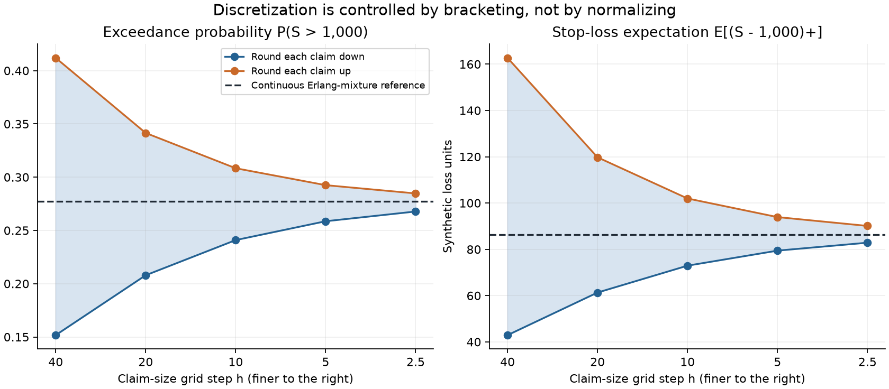
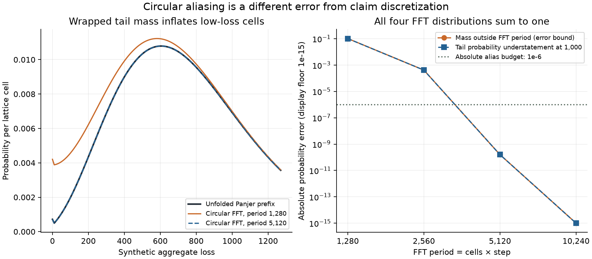

# Compound Loss FFT Audit

[](https://github.com/lcx0731/compound-loss-fft-audit/actions/workflows/tests.yml)

**A probability distribution can sum to one and still give the wrong tail risk.**
This compact actuarial numerical experiment separates two error sources when
computing an insurance portfolio's aggregate loss: rounding individual claims to
a grid, and wrapping an unbounded distribution into a finite FFT period.

It combines a Poisson Panjer recursion, an independent continuous benchmark,
pathwise discretization bounds, and an intentionally undersized FFT counterexample.
The code is an original educational implementation of established methods, not
a new research result or a fitted insurance model.

## Reproduce

Python 3.11 or newer:

```bash
python3 -m venv .venv
source .venv/bin/activate
python -m pip install '.[test]'
python -m pytest -W error
compound-loss-audit --output results
```

This creates `summary.json`, `discretization.png`, and `aliasing.png`. The command
checks seven numerical invariants before saving results. The audit itself is
deterministic and needs no seed, downloads, account, or credentials. One independent
Monte Carlo unit test uses the fixed seed `20261003`.

The recorded figures and numbers are in [artifacts](artifacts/summary.json).
For the recorded Python 3.13 dependency versions, install with:

```bash
python -m pip install -c constraints-python313.txt '.[test]'
compound-loss-audit --output results
```

CI uses the supported version ranges on Python 3.11 and 3.13. The constraints file
records runtime and test dependencies, not a cross-platform binary lockfile.
After changing source, reinstall with `python -m pip install --no-deps .`.

## Synthetic model and quantities

All parameters are illustrative; there are no observed claims, private files,
market data, or personal records.

$$
N\sim\operatorname{Poisson}(8),\qquad
X_i\overset{\mathrm{iid}}\sim\operatorname{Exponential}(\text{mean}=100),\qquad
S=\sum_{i=1}^{N}X_i.
$$

Frequency and severities are independent. Thus `E[S] = 800` and `Var(S) = 160000`.
Amounts are arbitrary synthetic loss units, not a real currency. Retentions
`d = 1000, 1600, 2000` are evaluated using:

- **Exceedance:** `P(S > d)`, with a strict inequality even on a lattice.
- **Stop-loss:** `E[max(S - d, 0)]`, an unconditional expected excess amount,
  not expected shortfall, a conditional tail mean, or a loaded premium.

## 1. Control claim discretization by bracketing

For step `h`, round **each claim** down or up before summing:

$$
S_h^- = \sum_i h\lfloor X_i/h\rfloor
\ \leq\ S\ \leq\
S_h^+ = \sum_i h\lceil X_i/h\rceil.
$$

Both risk quantities are increasing functions of total loss, so their lattice
values bracket the continuous values. For exponential severities, the number of
grid steps is geometric. With `q = exp(-h / 100)`, floor probabilities are
`p[k] = (1-q) q^k`, `k >= 0`; ceil probabilities are shifted up by one cell.

The Poisson specialization of the
[Panjer recursion](https://www.casact.org/sites/default/files/database/astin_vol12no1_22.pdf)
computes aggregate cells without Monte Carlo:

$$
g_0=\exp\{\lambda(p_0-1)\},\qquad
g_k=\frac{\lambda}{k}\sum_{j=1}^k j p_j g_{k-j}.
$$

Nonzero severity mass at zero is handled explicitly. A prefix ending at cell `k`
does not require severity probabilities above `k`, and neither input nor output
prefixes are renormalized. Complexity is quadratic in the number of cells.

Stop-loss uses the full analytical lattice mean rather than discarding the
uncomputed tail:

$$
\mathbb E[(S_h-d)^+]=\mathbb E[S_h]
-\sum_{k\leq d/h}kh\,g_k-d\Pr(S_h>d).
$$

The upper/lower stop-loss gap is at most `E[N] h = 8h`, because the positive-part
function is 1-Lipschitz. Halving `h` produces nested bounds pathwise. These are
mathematical bounds for the specified model, not confidence intervals or
floating-point interval certificates.

### Independent continuous reference

Conditional on `N = n >= 1`, the total is Erlang with shape `n` and scale `100`.
The reference mixes Erlang survival and expected-excess formulas with Poisson
weights using SciPy's [regularized upper incomplete gamma function](https://docs.scipy.org/doc/scipy/reference/generated/scipy.special.gammaincc.html).
For shape `n`, scale `theta`, and `z = d / theta`:

$$
\Pr(S>d\mid N=n)=Q(n,z),\qquad
\mathbb E[(S-d)^+\mid N=n]
=\theta n Q(n+1,z)-dQ(n,z).
$$

The count mixture stops at `K = 36` in the default run. Omitted probability is
bounded by `P(N > K) = 8.01e-14` (rounded upward); omitted stop-loss is at most
`100 × 8 × P(N >= K) = 2.99e-10` loss units (rounded upward). These bounds exclude
floating-point error. The omitted probability is never reassigned or normalized.

### Recorded result at retention 1,000

Continuous reference: exceedance **0.2771115561**, stop-loss **86.42259328**.

| Step h | Floor exceedance | Ceil exceedance | Floor stop-loss | Ceil stop-loss |
|---:|---:|---:|---:|---:|
| 40 | 0.151697 | 0.412004 | 42.917967 | 162.714482 |
| 20 | 0.207913 | 0.341503 | 61.320286 | 119.757136 |
| 10 | 0.240933 | 0.308397 | 72.937330 | 101.968077 |
| 5 | 0.258640 | 0.292512 | 79.434311 | 93.926065 |
| 2.5 | 0.267782 | 0.284750 | 82.865537 | 90.108456 |

Even the finest grid shown leaves a visible interval. The project reports that
remaining uncertainty rather than treating one discretized value as exact.



## 2. Audit circular FFT aliasing separately

At a **fixed floor grid with h = 10**, the exact infinite-support severity
probability-generating function is `H(z) = (1-q)/(1-qz)`; the aggregate PGF is
`exp(8 × (H(z)-1))`. Evaluating it at `M` roots of unity and applying the inverse
FFT returns the distribution of the aggregate lattice index **modulo M**.
The implementation follows [NumPy's Fourier sign and normalization convention](https://numpy.org/doc/stable/reference/routines.fft.html).

In exact arithmetic, for `k = 0, ..., M-1`:

$$
g_k^{\mathrm{FFT}}=\sum_{r=0}^{\infty}g_{k+rM},\qquad
\sum_{k=0}^{M-1}g_k^{\mathrm{FFT}}=1.
$$

Consequently, all tail mass beyond the period `M × h` wraps into lower cells.
The L1 difference from the **unfolded, unnormalized** Panjer prefix equals the
outside probability `P(S_h >= M h)`. That probability also bounds the absolute
exceedance error at any lattice retention inside the period. Using an analytical
severity PGF isolates aliasing: there is no additional severity-tail truncation.

The proper benchmark here is the **same discrete model**, whose true exceedance
at 1,000 is approximately **0.2409328393**, not the continuous value 0.2771115561.

| FFT cells | Period | FFT mass | Circular exceedance | Absolute tail understatement |
|---:|---:|---:|---:|---:|
| 128 | 1,280 | 1.000000 | 0.1386553145 | 0.1022775249 |
| 256 | 2,560 | 1.000000 | 0.2405174897 | 0.0004153496 |
| 512 | 5,120 | 1.000000 | 0.2409328392 | 1.59e-10 |
| 1,024 | 10,240 | 1.000000 | 0.2409328393 | Roundoff scale |

For this model, periods 5,120 and 10,240 pass the predeclared **absolute alias
budget of 1e-6**, using the Panjer outside-mass diagnostic. That says nothing
about the separate `h = 10` discretization error. A unit mass check alone accepts
even the badly aliased first row.



## Verification and layout

44 tests cover unit-claim Poisson recovery, zero-claim thinning, direct convolution
agreement, prefix invariance, geometric moments, full-mean stop-loss accounting,
the atom at zero, count-truncation bounds, seeded simulation, modular folding,
aliasing counterexamples, nested bounds, invalid inputs, underflow rejection,
determinism, and real output artifacts. Both CI matrix jobs also run the full CLI.

```text
src/loss_audit/lattice.py     Panjer, exact geometric PGF, risk functionals
src/loss_audit/reference.py   Independent Poisson–Erlang mixture with error bounds
src/loss_audit/experiment.py  15 discretization comparisons + 4 FFT periods
src/loss_audit/plotting.py    Two static figures
tests/                      Numerical identities, edge cases, workflow checks
artifacts/                  Recorded JSON and figures
```

## Limitations and interpretation

- Poisson frequency and independent exponential claim sizes are deliberately
  simple. Real claim dependence, inflation, heavy tails, deductibles, limits,
  parameter uncertainty, and model selection are not addressed.
- The closed-form geometric PGF is specific to this benchmark. Arbitrary severity
  models would require their own discretization and truncation audit.
- The implementation favors clarity, not production scalability: Panjer is
  quadratic, while FFT is `O(M log M)`. No wall-clock speedup is claimed.
- Double precision limits tiny-tail accuracy. The largest-period JSON retains
  tiny negative FFT cells and signed errors from roundoff; it does not clip or
  renormalize the FFT output. The plot alone floors probability errors at `1e-15`
  for display. `panjer_mass_outside_period` is a numerical benchmark, not a
  certified tail bound below machine resolution. High-frequency Panjer initial
  underflow is explicitly rejected. Very fine `h / scale < 1e-10` is also rejected.
- The seven numerical checks use explicit tolerances; they supplement, rather
  than prove, the mathematical identities. Bounds for the model do not measure
  uncertainty about a real insurance portfolio.

Educational use only; not investment, insurance pricing, or actuarial advice.
MIT licensed. No claimed employment, investment performance, or empirical
insurance conclusion is implied.
